# Deliverable 4: changes since D3

Pipeline: raw data → clean data → parameter estimation → model + settings → monthly backtest.

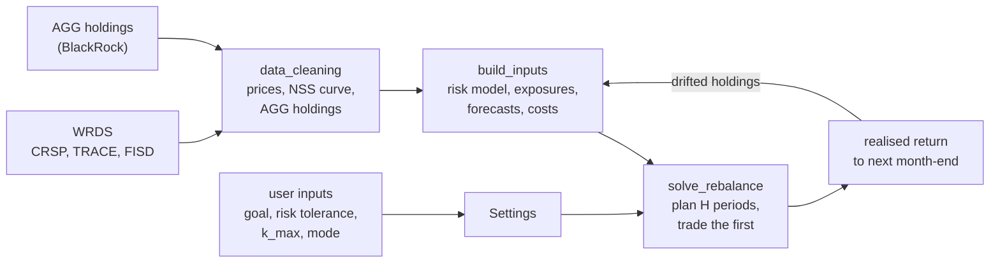

## Data

The benchmark for month $m$ comes from AGG's holdings on the last trading day of $m-1$, so we never use holdings we wouldn't have known at the time. We keep Treasuries, corporates (industrial, financial institutions, utility) and MBS pass-throughs, which together make up about 95% of AGG's bond value. Each bond's weight $b$ is its `agg_market_value` over the total for the asset types the user selects.

Prices come from WRDS: CRSP for Treasuries, TRACE for corporates and MBS pools, and FISD for corporate bond terms. Everything is joined on the 9-character CUSIP.

The Treasury data needed little work. We drop TIPS and callables, take the mid price (bid + ask) / 2, and add accrued interest to get the dirty price. We fit a Nelson-Siegel-Svensson zero curve to all nominal Treasury dirty prices each day and read zero yields off at the 8 key rates (6m, 1y, 2y, 3y, 5y, 7y, 10y, 30y).

TRACE needed more. It reports individual trades, so we first remove cancelled, corrected and reversed trades, inter-dealer duplicates, non-standard and long-settlement trades, and price outliers, following the Dick-Nielsen and Edwards-Harris-Piwowar filters. We then collapse to one row per bond per day using the face-weighted average price, and keep clean price, yield, bid-ask spread (dealer-sell minus dealer-buy VWAP), volume and trade count. For MBS, quantities are reported against original face, so we multiply by the pool factor (the share of principal still outstanding) to get current face.

Many bonds trade rarely. A bond's month-end price is its last price in the month's final 5 trading days, and if it didn't trade we carry the previous month-end forward and flag it `stale`. Accrued interest is recomputed from the coupon schedule rather than carried. An MBS pool with no trades that month moves with its coupon cohort. `spread_bps` is the constant spread over the zero curve that reprices the dirty price. The daily price table is never filled.

All three asset types have prices from 2017-08 to 2025-02 (MBS data ends first). The curve runs to 2025-12.

## Parameter estimation

`build_inputs(asof, W, H)` estimates every input at a rebalance date from data up to that date only.

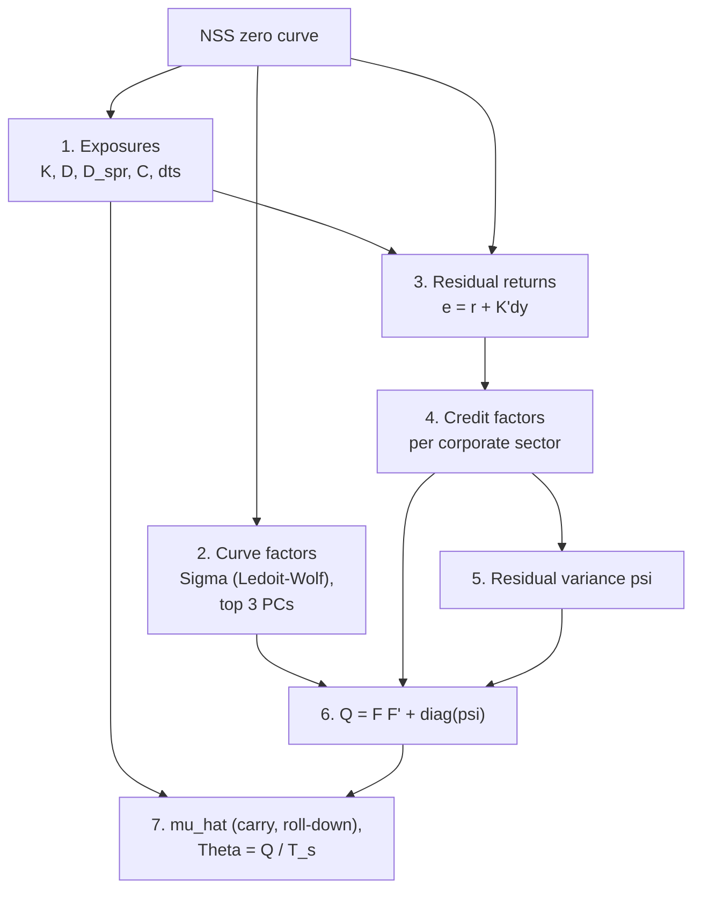

1. **Exposures.** Each bond is priced off the zero curve plus its own constant spread $s_i$, with callables treated as bullets. Bumping the curve and spread and repricing gives key-rate durations `K` (8 per bond), duration `D`, spread duration `D_spr`, convexity `C` and $\text{dts}_i = D^{spr}_i s_i$. These feed the exposure constraints and the factor loadings.
2. **Curve factors.** The 8 x 8 covariance `Sigma` of month-end key-rate changes $\Delta y$ is estimated with Ledoit-Wolf shrinkage. PCA keeps 3 components (level, slope, curvature), about 89% of the variance at 2022-01-31. Curve loadings are $K \Gamma \Lambda^{1/2}$.
3. **Residual returns.** For each past month, the part of a bond's return explained by the curve move is removed: $e_{ik} = r_{ik} + K_{i,k-1}^\top \Delta y_k$. Returns touching a stale price are dropped.
4. **Credit factors.** In each corporate sector $g$, the residuals share a common spread change $s_{gk}$, fitted each month by regressing $e$ on $-D^{spr}$. It is removed from the residuals, $u_{ik} = e_{ik} + D^{spr}_i s_{gk}$. Its covariance (Ledoit-Wolf) gives the credit loadings.
5. **Residual variance.** `psi` is each bond's variance of $u$, shrunk toward a duration-scaled sector prior with a 12-month prior weight: $\psi_i = (n_i s_i^2 + 12\,\text{prior}_i)/(n_i + 12)$. Bonds with under 6 months take the prior.
6. **Covariance.** $Q = F F^\top + \mathrm{diag}(\psi)$, with $F$ holding 3 curve and 3 credit loadings. Tracking variance is computed as $a^\top Q a = \|F^\top a\|^2 + \sum_i \psi_i a_i^2$, so the $n \times n$ matrix is never built.
7. **Expected returns.** `mu_hat` is carry and roll-down: reprice each bond at the next month-end off today's curve and spread, plus coupons. Estimation error in `mu_hat` is $\Theta = Q / T_s$.
8. **Frictions.** One-way cost `c` is half the last bid-ask spread in the 90 days to the as-of date. Minimum lot `ell` is minimum denomination times dirty price, as a share of wealth `W`.

## Model

Active weights are $a_h = x_h - \hat b_h$. The robust active return penalizes estimation error in $\hat\mu$:

$$\rho_h = \hat\mu_h^\top a_h - \varepsilon_2 \|\Theta^{1/2} a_h\|$$

Tracking variance is $V_h = a_h^\top Q_h a_h$. There are two objectives (`mode`).

**Tracking mode.** Minimize tracking variance and trading cost, with a soft goal on active return ($s_h$ is the shortfall, penalized by $\lambda$ = `goal_penalty`):

$$\min \sum_{h=0}^{H-1} \Big[\, \gamma\, \omega_h V_h + \kappa\, c^\top (u_h^+ + u_h^-) + \lambda\, \omega_h s_h \,\Big] \quad \text{s.t.} \quad \rho_h + s_h \ge g_m,\; s_h \ge 0$$

**Return mode.** Maximize robust active return within the risk limits. There is no goal constraint, and a small $\gamma$ breaks ties:

$$\min \sum_{h=0}^{H-1} \Big[\, -\omega_h \rho_h + \gamma\, \omega_h V_h + \kappa\, c^\top (u_h^+ + u_h^-) \,\Big]$$

**Constraints** (every period $h$, both modes):

| constraint | form |
|---|---|
| trades, drift | $x_h - \tilde x_h = u_h^+ - u_h^-$, $\tilde x_h$ = planned holdings drifted by $\hat\mu$ |
| budget, long only | $\mathbf 1^\top x_h = 1$, $x_h \ge 0$ |
| active weight cap | $x_h \le \hat b_h + \bar w$ |
| duration, key rates | $\lvert D_h^\top a_h \rvert \le \delta_D$, $\lvert K_{h,j}^\top a_h \rvert \le \delta_{K,j}$ |
| DTS, convexity | $\lvert \mathrm{dts}_h^\top a_h \rvert \le \delta_{DTS}$, $\lvert C_h^\top a_h \rvert \le \delta_C$ |
| tracking error cap | $\sqrt{12\, V_h} \le$ `te_cap` |
| exits | $x_{h,i} = 0$ under one year to maturity |
| cardinality, min lot | $\ell_{h,i} z_{h,i} \le x_{h,i} \le z_{h,i}$, $\sum_i z_{h,i} \le k_{max}$ |

**Bands relative to the benchmark.** Instead of tuning a scalar band per exposure, each band is a share of the benchmark's own exposure, with a floor: $\delta = \max(\mathrm{tol}_{rel} \cdot \lvert \hat b_h^\top v \rvert,\ \text{floor})$. Risk tolerance scales `tol_rel` (only $\delta_D$ stays flat). Example: a benchmark 10y KRD of 2.15 gives a band of $\pm 0.215$ at medium.

**Spread exposure.** Under a constant additive spread, `D_spr` equals `D` for spread products, so the spread-duration constraint in D3 is replaced by DTS.

**Feasibility.** If a solve is infeasible, every band and the TE cap are widened by $\sigma$ = 2, 4, then 8.

**Goal check.** Before running, we check that the return goal isn't too large for the risk the user allows. We cap the information ratio (active return over tracking error) the goal implies at 1. So if the user allows 100 bp of tracking error, we treat 100 bp/yr of active return as the most they can ask for:

$$g \le \mathrm{IR}_{max} \cdot \mathrm{TE}_{cap}, \qquad \mathrm{IR}_{max} = 1$$

A goal above this is rejected with a message to lower the goal or raise the risk tolerance. Medium (50 bp cap) allows at most 50 bp/yr. This is a rough bound, not an exact feasibility test: the optimizer's goal uses expected returns, and the realized IR can come out higher (1.30 in the backtest below). It mainly stops the user from pairing a large goal with a tight risk tolerance.

## Multi-period planning and aging

At each rebalance we plan over $H$ = 2 months and trade only the first. Later periods make today's trade account for next month's drift, exits and costs.

Bonds are aged under the rebalance date's curve held fixed. At each future date we recompute `b_hat`, `mu_hat`, `K`, `D`, `dts`, `C`, `F` and the exits (under one year to maturity). `b_hat` drifts by $(1 + \hat\mu)$, zeroes the exits and renormalizes. Planned holdings drift the same way, normalized by the forecast benchmark return to stay linear in $x$.

We don't forecast curve moves, new issues, defaults, downgrades or MBS prepayments. The robustness term $\Theta$ only covers estimation error in $\hat\mu$. Curve scenarios are still future work.

## Goal catch-up

$g$ is a goal over the whole horizon. In tracking mode, each month asks for the rate that still reaches it from the cumulative active growth $A$ so far:

$$g_{req} = \mathrm{clip}\!\left( \left( \frac{(1 + g_m)^N}{A} \right)^{1/(N - k)} - 1,\ 0,\ 2 g_m \right)$$

If the portfolio is ahead, the goal can fall to 0, so it just tracks the benchmark and keeps the gain. If it's behind, the goal rises, but we cap it at twice the original monthly goal so it stays within what the risk limits allow. Catch-up can be turned off (`[catch_up]`).

## Computation

**Candidate set.** The optimizer chooses from the 750 largest eligible benchmark weights plus current holdings. Tracking is still measured against the full benchmark. This replaces D3's plan for stratified sampling against about 27,000 binaries.

**Cardinality.** A two-stage heuristic solves the continuous relaxation, keeps the $k_{max}$ largest weights, enforces minimum lots and re-solves. For the MISOCP (`method = "misocp"`), Gurobi starts from the heuristic solution, with binaries only on a short list of bonds, and stops at a 1% gap or the time limit.

**Gurobi.** The gurobipy backend runs all stages in one model and changes bounds in place. A heuristic solve averages 0.22 s per month in the backtest below.

**Estimation.** Each month's residual returns are computed once and shared across dates. This cuts `build_inputs` from 5 to 25 s per date to under a second. Results are cached on disk, so runs that change only risk tolerance, mode or `k_max` reuse them.

## User inputs

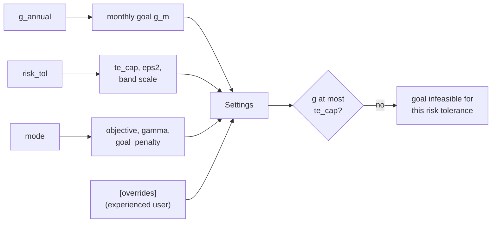

A non-expert user enters asset types, annual active goal `g_annual`, start and horizon `T`, risk tolerance (low, medium, high), maximum holdings `k_max`, wealth `W` and `mode`. Presets map these to solver settings. Low risk tolerance is tight on all three:

| `risk_tol` | `te_cap` (annual) | `eps2` | band scale |
|---|---|---|---|
| low | 25 bp | 0.50 | 0.5 |
| medium | 50 bp | 0.25 | 1.0 |
| high | 100 bp | 0.10 | 2.0 |

The active goal is how far above the benchmark the user wants to be, and the risk tolerance is how far from the benchmark they will allow. A high goal needs a high risk tolerance, which the IR check enforces. An experienced user can override any solver setting (`[overrides]`), such as bands, `te_cap`, `goal_penalty`, $H$ or the solve method. Preset values are placeholders until calibration.

## Results

Backtest: corporate + treasury, 48 monthly rebalances from 2021-01 to 2024-12, $g$ = 50 bp/yr, medium risk tolerance, $k_{max}$ = 150, tracking mode, $W$ = 1M.

| metric | value |
|---|---|
| cumulative return, portfolio / benchmark | -5.48% / -7.34% |
| active return, annualized | +50.1 bp (goal met) |
| tracking error, realized monthly / ex-ante average | 38 / 20 bp (cap 50) |
| information ratio | 1.30 |
| hit rate | 65% of months |
| turnover, average after first month | 12.4% |
| trading cost, total | 35.2 bp |
| active share, average | 88% |
| months short of the monthly goal | 7 |
| solve time, average | 0.22 s |

### Returns and goal

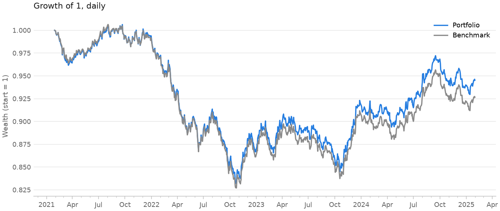

Daily marked wealth of the portfolio (net of costs) and the benchmark. Both fall through the 2022 rate rise, and the portfolio pulls ahead from 2023.

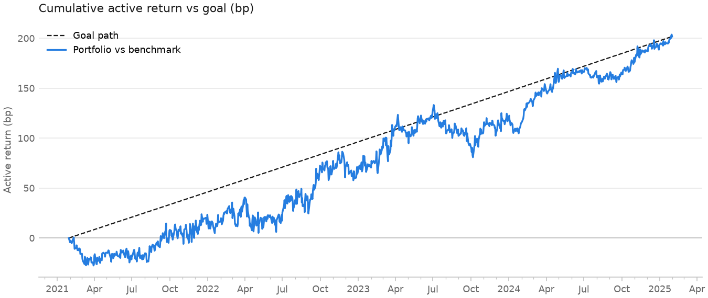

Active return falls behind early and reaches the goal path by the end of the horizon. Around April 2023, May 2024 and November 2024 it sits right on the goal path, which is the catch-up mechanism lowering the target once the portfolio is ahead.

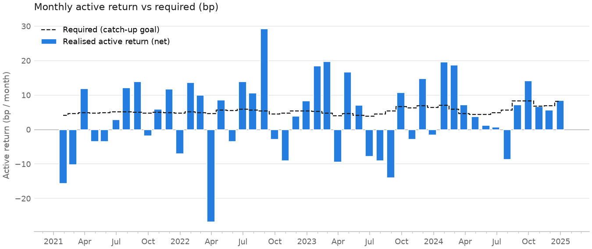

Catch-up raises the monthly requirement after a miss and lowers it when ahead.

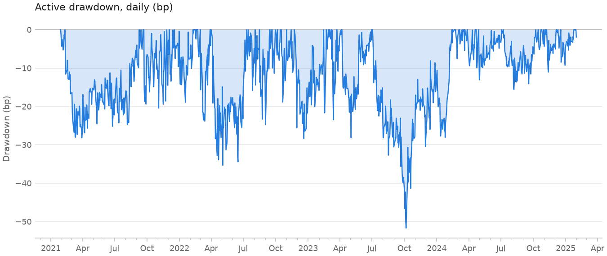

The largest daily fall below the peak active return is 52 bp (late 2023). Most drawdowns stay within 30 bp.

### Risk

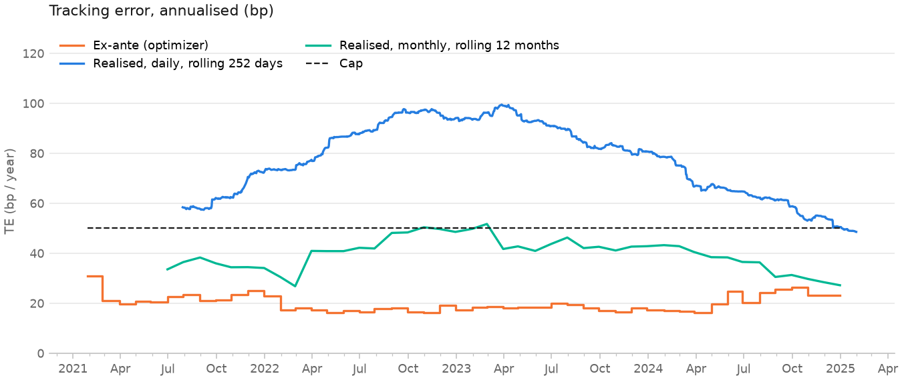

Realized monthly TE stays mostly under the 50 bp cap but runs about twice the ex-ante forecast, so the risk model underestimates tracking error. Daily TE is higher because illiquid corporates are marked at their last trade.

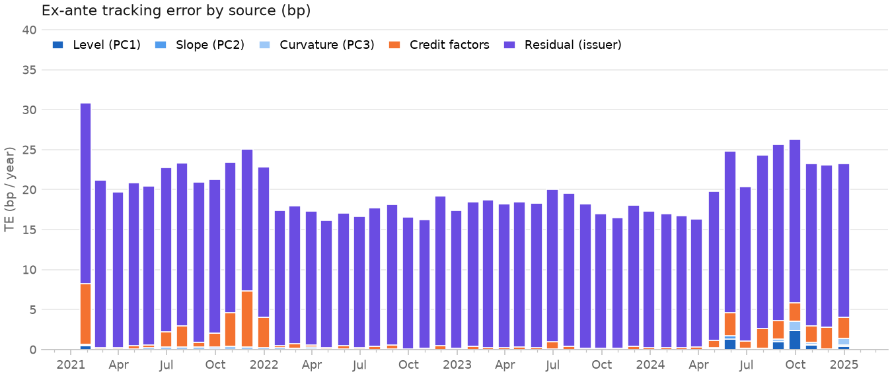

Most forecast TE is residual (issuer) risk. The KRD bands keep curve risk small, and credit factors contribute in a few months.

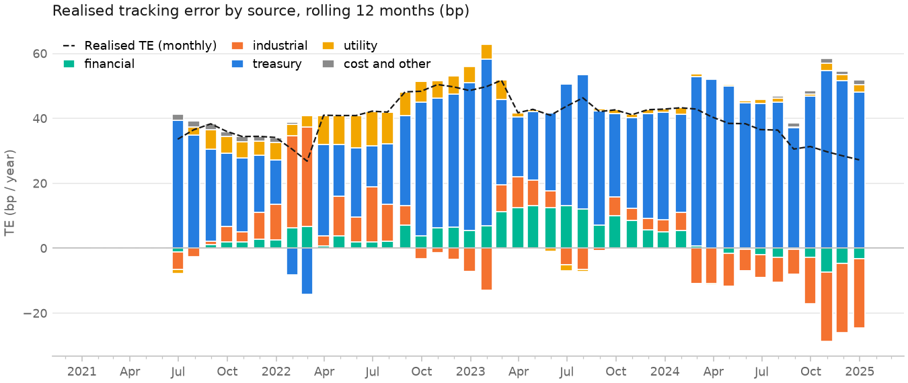

Realized TE comes mostly from the Treasury underweight, with industrials acting as a partial hedge from 2024.

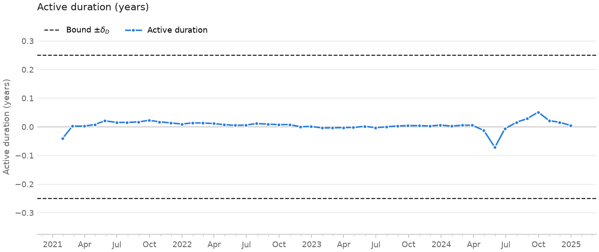

Active duration stays near 0, well inside the ±0.25 year bound.

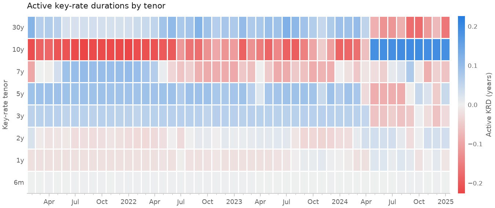

Active KRDs stay within about ±0.2 years at every tenor. The 10y and 30y positions flip sign in mid-2024.

### Positioning

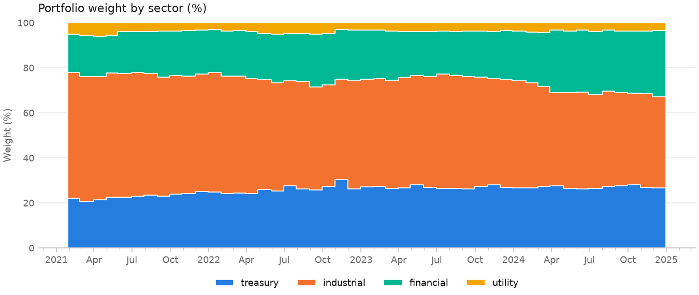

The portfolio holds about 25% Treasuries, 40 to 55% industrials and 17 to 30% financials.

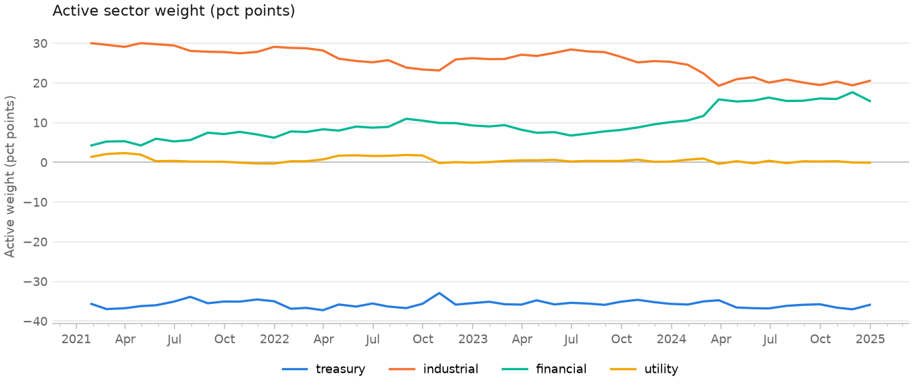

The main active bet is a steady Treasury underweight of about 36 points, funded by industrials (+20 to 30) and financials (+5 to 17). This is likely corporates' higher carry in `mu_hat` (not yet checked).

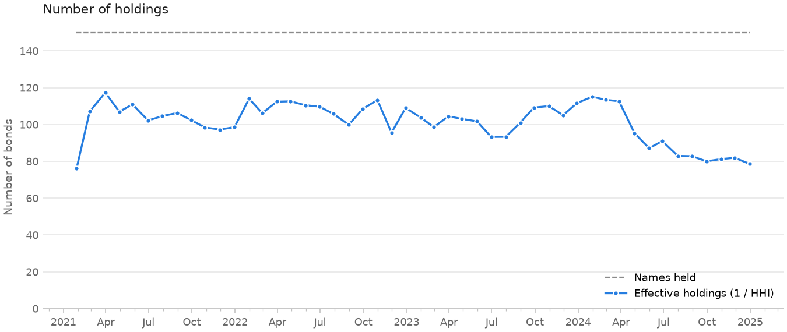

The portfolio always holds the full 150 names. Effective holdings are about 100, falling to 80 from mid-2024.

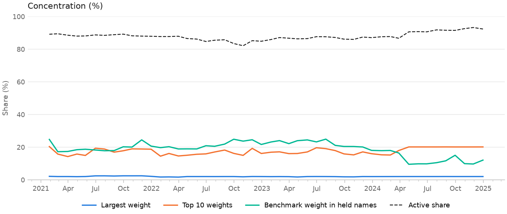

The largest weight stays near 2% and the top 10 near 15 to 20%. The held names cover about 20% of benchmark weight (10% from mid-2024), so active share is close to 90%.

### Trading

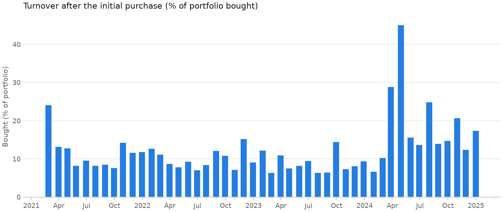

Turnover is about 10% a month, with spikes in spring 2024 (up to 45%).

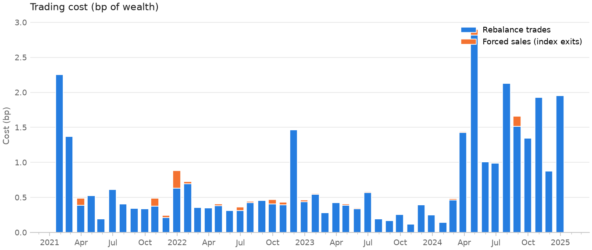

Monthly cost is mostly under 1 bp, rising to 1 to 3 bp with the 2024 turnover. Forced sales of bonds leaving the index are a small share.

## Questions for Charlie

1. Do we need to discuss the code implementation (e.g. that parameter estimation and the preliminary model are coded up)?
2. Our model contains a lot of parameters. In the final report is it expected that we have a comprehensive discussion of how each parameter impacts model results? Or is it sufficient to discuss the most important parameters?
3. Realized TE is about twice our forecast. Should we calibrate the risk model (e.g. scale `psi`) before the final report, or is reporting the gap enough?
4. Are there any other graphs or figures we should show regarding portfolio performance? 