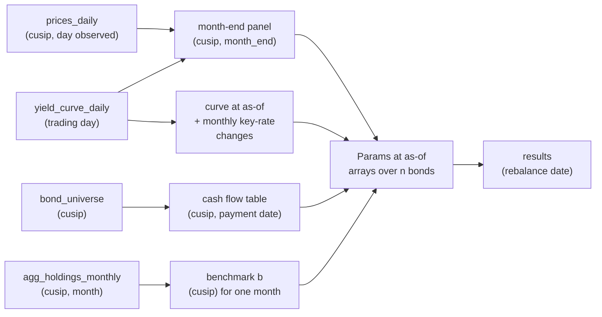

# Data

The model reads four tables from `data/processed/`, built by `data_cleaning/` (see its README). Examples below are from the current files.

## Grain at each stage

| stage | grain | size |
|---|---|---|
| `bond_universe` | one row per cusip | 20,619 (16,277 corporate, 3,624 mbs, 718 treasury) |
| `prices_daily` | (cusip, date) on days with an observation | 11.3M rows, 2017-08-01 to 2026-03-17 |
| `yield_curve_daily` | one row per trading day | 2,106 rows, 2017-08-01 to 2025-12-31 |
| `agg_holdings_monthly` | (cusip, month) | 896,676 rows, 104 months, 5.6k to 11.8k bonds per month |
| month-end panel | (cusip, month_end) | 1.16M rows, 2017-08 to 2025-12 |
| `Params` at one as-of | arrays of length $n$ | $n$ = 6,953 at 2022-01-31 (corporate + treasury) |
| results | one row per rebalance | $N = 12T$ rows |

## Tables

`bond_universe`: terms per bond. The model uses `cusip`, `asset_type`, `sector`, `maturity_date`, `coupon_rate`, `coupon_frequency`, `min_denomination`.

| cusip | asset_type | sector | maturity_date | coupon_rate | coupon_frequency | min_denomination |
|---|---|---|---|---|---|---|
| 00037BAB8 | corporate | industrial | 2022-05-08 | 2.875 | 2 | 2000 |
| 00037BAC6 | corporate | industrial | 2042-05-08 | 4.375 | 2 | 2000 |

`prices_daily`: one row per bond per day it was quoted (Treasuries) or traded (corporates, MBS). Nothing is forward-filled. Prices are per 100 face.

| cusip | date | clean_price | accrued_interest | dirty_price | spread_bps | bid_ask_spread_bps |
|---|---|---|---|---|---|---|
| 00037BAB8 | 2017-08-22 | 102.559 | 0.831 | 103.390 | 54.98 | NaN |
| 00037BAB8 | 2017-08-24 | 102.749 | 0.847 | 103.596 | 51.34 | NaN |

`spread_bps` is the constant spread over the same-day fitted zero curve that reprices the dirty price.

`yield_curve_daily`: the fitted Nelson-Siegel-Svensson (NSS) zero curve. Zero yields at the 8 key rates (6m, 1y, 2y, 3y, 5y, 7y, 10y, 30y, continuously compounded, decimal) plus the NSS parameters `beta0..beta3`, `tau1`, `tau2`. Its dates are also the trading calendar.

| date | zero_6m | zero_2y | zero_10y | zero_30y | beta0 | tau1 |
|---|---|---|---|---|---|---|
| 2017-08-01 | 0.01135 | 0.01356 | 0.02320 | 0.03092 | 0.1095 | 3.54 |

`agg_holdings_monthly`: AGG holdings per month, used for the benchmark.

| holdings_date | cusip | asset_type | agg_market_value |
|---|---|---|---|
| 2017-07-31 | 00037BAB8 | corporate | 3,729,915 |
| 2017-07-31 | 00037BAC6 | corporate | 1,216,696 |

## Month-end panel

`load_data()` (`src/params/inputs.py`) loads the first three tables and builds the panel with `month_end_prices` (`src/params/prices.py`). It is cached for the session.

Rule: for each bond and month, take the last daily price within the month's final 5 trading days. If there is none, carry the previous month-end forward and set `stale = True`. Rows before a bond's first price do not exist.

| cusip | month_end | dirty_price | spread_bps | bid_ask_spread_bps | obs_date | stale |
|---|---|---|---|---|---|---|
| 931142DQ3 | 2017-08-31 | 112.700 | 96.14 | NaN | 2017-08-25 | False |
| 931142DQ3 | 2017-09-29 | 113.175 | 88.07 | 22.84 | 2017-09-29 | False |
| 931142DQ3 | 2017-10-31 | 113.793 | 74.01 | 22.84 | 2017-10-31 | False |

Stale prices value holdings but are excluded from the residual variance estimate (any return touching one is dropped), and stale bonds are not candidates.

Month-ends follow the curve calendar, so the panel ends 2025-12-31 although TRACE runs to 2026-03.

## Usable window

`presets.horizon_dates(ends, start, T)` returns the first $N = 12T$ month-ends from the start month and the month-end after the last one (to measure its return). It checks:

- 7 month-ends of history before the start (6 monthly curve changes for `Sigma` and `psi`), so the earliest start is 2018-03.
- a month-end after the last rebalance, so the last rebalance can be 2025-11.

Example: `start = "2022-01"`, `T = 2` gives 24 rebalances 2022-01-31 to 2023-12-29, last return measured to 2024-01-31.

## Benchmark

Done in `src/backtest/benchmark.py` (`Benchmark.weights_at`, `data_for`). For month $t$, keep the holdings of the selected asset types and set

$$b_i = \frac{\text{agg\_market\_value}_i}{\sum_{j \in \text{selected}} \text{agg\_market\_value}_j}$$

`data_for(d)` cuts the universe to the bonds in that month's benchmark. `build_inputs` takes `agg_weight` from the same month's holdings file (matched by month, since a file can be dated after the last trading day, e.g. 2021-05-31), which is proportional to market value, so the result equals $b$ above. It then drops bonds with no month-end price at the as-of date, matured bonds, bonds without a coupon and bonds whose price gives no valid spread, and renormalizes $b$ over the rest.

Example at 2022-01-31, corporate + treasury: 7,173 benchmark bonds, 6,953 kept (6,708 corporate, 245 treasury).
