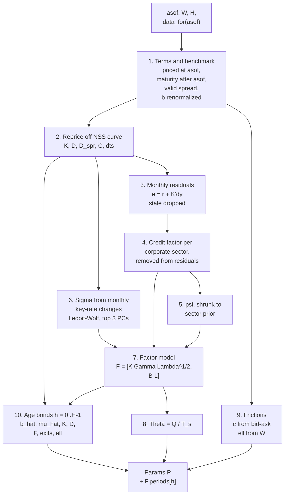

# Estimation

`src.params.build_inputs` computes every optimizer input for one rebalance date from data up to that date only. It does not optimize. The notebook calls it once per rebalance:

```python
P = build_inputs(asof, W, H=settings.H, data=data_for(asof))
```

About 13 s per date for corporate + treasury in 2022, longer later in the sample (it refits residuals over the full history to `asof`).

| arg | default | meaning |
|---|---|---|
| `asof` | | rebalance month-end, must have a fitted curve |
| `W` | | wealth in dollars, sets the minimum-lot weights |
| `H` | 2 | planning periods, one `PeriodInputs` each |
| `sigma_method` | `ledoit_wolf` | `sample`, `ewma` or `ledoit_wolf` for the key-rate covariance |
| `p` | 3 | principal components kept |
| `freq`, `window` | `M`, None | monthly or daily (scaled by 21) curve changes, optional lookback in periods |
| `credit` | True | one credit factor per corporate sector |
| `psi_n0` | 12 | prior weight in months for `psi`; None gives the plain sample variance with a sector median fill |
| `min_obs` | 6 | residual returns a bond needs for its own variance |
| `data` | `load_data()` | the notebook passes `data_for(asof)`, with the benchmark in `agg_weight` |
| `G`, `t_index`, `N` | None | terminal wealth goal for `r_req`. Unused by the notebook, which sets the goal through `Settings.ret_slack` |

## Steps



### 1. Terms and benchmark

Join the universe (already cut to the month's benchmark) to the panel at `asof`. Keep bonds that mature after `asof`, have a coupon, and give finite analytics in step 2. $b$ is `agg_weight` renormalized to sum 1. Treasuries get no credit risk: their spread to the fitted curve is a pricing residual.

### 2. Repricing (`krd.py`)

Each bond is priced off the fitted zero curve $z(\tau)$ plus its own constant spread $s_i$ (from `spread_bps`, or solved from the dirty price when missing), with callables treated as bullets:

$$P_i = \sum_k CF_{ik}\, e^{-(z(\tau_k) + s_i)\tau_k}$$

Sensitivities are finite differences, in years per unit yield change:

| output | bump |
|---|---|
| $K_{ij}$, 8 key rates | 1 bp triangular bump at key rate $j$, linear to 0 at the neighbouring key rates (the 8 bumps sum to a parallel shift) |
| $D_i$ | 1 bp parallel shift of $z$ |
| $D^{spr}_i$ | 1 bp shift of $s_i$, set to 0 for Treasuries |
| $C_i$ | $\pm 10$ bp parallel, $(P^+ + P^- - 2P)/(P h^2)$ |
| $\mathrm{dts}_i$ | $D^{spr}_i \, s_i$ (0 for Treasuries) |

With a constant additive spread, $D^{spr} = D$ for spread products.

### 3. Residual returns (`residual.py`)

For each pair of consecutive month-ends up to `asof`, the total return and its residual after the curve move:

$$r_{ik} = \frac{P^{dirty}_{ik} + \text{cash}_{i,(k-1,k]} - P^{dirty}_{i,k-1}}{P^{dirty}_{i,k-1}}, \qquad e_{ik} = r_{ik} + K_{i,k-1}^\top \Delta y_k$$

$K_{i,k-1}$ is recomputed at each past month-end off that month's curve. Returns with a stale price at either end are dropped. Grain: an $n \times T$ matrix $E$ with NaN where invalid.

### 4. Credit factors

Each corporate sector $g$ (financial, industrial, utility) gets one factor per month: the common spread change that best explains its bonds' residuals,

$$s_{gk} = -\frac{\sum_{i \in g} D^{spr}_i e_{ik}}{\sum_{i \in g} (D^{spr}_i)^2}$$

over bonds with a valid residual that month, NaN under 20 bonds. $D^{spr}$ at `asof` is used for every past month. If fewer than 3 months have every sector, the sparsest sector is dropped until that holds (its bonds keep the credit risk in $\psi$). The factor is removed from the residuals, $u_{ik} = e_{ik} + D^{spr}_i s_{gk}$, and the factor covariance is Ledoit-Wolf over the complete months, stored as its Cholesky factor $L$.

### 5. Residual variance $\psi$

Each bond's sample variance $s_i^2$ of $u_i$ over its $n_i$ months is shrunk toward a duration-scaled sector prior:

$$\kappa_{sec} = \operatorname{median}_{i \in sec} \frac{s_i^2}{\max(D_i, 0.25)^2}, \qquad \text{prior}_i = \max(D_i,0.25)^2 \kappa_{sec}, \qquad \psi_i = \frac{n_i s_i^2 + n_0\, \text{prior}_i}{n_i + n_0}$$

with $n_0 = 12$. Bonds under 6 observations take the prior alone.

### 6. Key-rate covariance (`covariance.py`)

Month-end changes $\Delta y$ of the 8 zero yields from 2017-08 to `asof`, Ledoit-Wolf covariance $\Sigma$ ($8 \times 8$), then its top 3 eigenvectors $\Gamma$ and eigenvalues $\Lambda$ (level, slope, curvature).

### 7. Factor model (`factor_model.py`)

$$Q = F F^\top + \mathrm{diag}(\psi), \qquad F = \big[\, K \Gamma \Lambda^{1/2},\; B L \,\big] \in \mathbb{R}^{n \times (3 + g)}$$

$B_{ig} = -D^{spr}_i$ if bond $i$ is in sector $g$, else 0. $Q$ ($n \times n$) is never formed. The tracking variance of active weights $a$ is

$$a^\top Q a = \|F^\top a\|^2 + \sum_i \psi_i a_i^2$$

### 8. Estimation error $\Theta$

Assumption (D3 does not define it): the covariance of a sample mean, $\Theta = Q / T_s$. In factor form the curve block is divided by $\sqrt{T_s}$ (months behind $\Sigma$), the credit block by the square root of the months behind $L$, and $\theta_{\psi} = \psi / T_s$. Built from the $h = 0$ loadings and used for every period.

### 9. Frictions (`frictions.py`)

- $c_i$: half the last `bid_ask_spread_bps` in the 90 days to `asof`, as a decimal. Missing takes the sector median, then the overall median.
- $\ell_i$: minimum denomination $\times$ dirty price / 100 / wealth. Missing denomination takes the sector median.

### 10. Aging over the horizon (`forecast.py`)

Period $h$ is month-end $t+h$. Every bond is aged under today's curve held constant (D3 Section 2.3).

| output | how |
|---|---|
| `mu_hat` | reprice at the next month-end off the same curve and spread, plus coupons paid: $\hat\mu_i = (P_i(t+h+1) + \text{cash}) / P_i(t+h) - 1$ |
| `b_hat` | $h = 0$: $b$. Then drift by $(1 + \hat\mu_{h-1})$, zero the exits, renormalize |
| `K`, `D`, `D_spr`, `C`, `dts`, `F` | recomputed at the aged date |
| `exits` | under one year to maturity at that date |
| `wealth` | grown at the forecast benchmark return $\hat b^\top \hat\mu$ |
| `ell` | at the forecast wealth and model price |
| `drift_gross`, `r_b` | $1 + \hat\mu_{h-1}$ and $\hat b_{h-1}^\top \hat\mu_{h-1}$, used to drift the planned portfolio. None and NaN at $h = 0$ |

$\Sigma$, $\psi$, $c$ and $\Theta$ do not change with $h$. Not forecast: curve moves, new issues, defaults and downgrades, prepayments.

## Output

`Params` (one per as-of, arrays over the $n$ bonds in `P.cusips`). Shapes at 2022-01-31, corporate + treasury, $n$ = 6,953:

| field | shape | meaning |
|---|---|---|
| `cusips`, `sector`, `asset_type` | (n,) | bond identifiers |
| `b` | (n,) | benchmark weights at `asof` |
| `model.Sigma` | (8, 8) | key-rate covariance, 53 monthly changes |
| `model.Gamma`, `model.Lambda`, `model.explained` | (8, 3), (3,), (3,) | PCs, explaining 70.9%, 13.8%, 4.7% |
| `model.credit_groups`, `model.credit_L` | 3 names, (3, 3) | financial, industrial, utility |
| `model.psi` | (n,) | residual variance |
| `c` | (n,) | one-way trading cost |
| `theta_F`, `theta_psi` | (n, 6), (n,) | $\Theta$ in factor form |
| `stale`, `spread_solved`, `n_resid_obs` | (n,) | data quality flags (4.1% stale) |
| `periods` | list of H | `PeriodInputs` |

`PeriodInputs` for period $h$:

| field | shape | at 2022-01-31 |
|---|---|---|
| `date` | | 2022-01-31, 2022-02-28 |
| `b_hat`, `mu_hat`, `D`, `D_spr`, `dts`, `C`, `ell` | (n,) | |
| `K` | (n, 8) | |
| `F` | (n, 6) | 3 curve + 3 credit factors |
| `exits` | (n,) bool | 6 at $h=0$, 51 at $h=1$ |
| `wealth`, `r_b` | scalar | |
| `drift_gross` | (n,) or None | |

Two bonds at 2022-01-31, $h = 0$:

| | 00037BAC6 (industrial) | 912810EP9 (treasury) |
|---|---|---|
| $b$ | 0.000003 | 0.000793 |
| $D$ / $D^{spr}$ | 14.02 / 14.02 | 0.99 / 0 |
| $K$ (6m..30y) | 0.01, 0.03, 0.07, 0.17, 0.32, 0.54, 7.32, 5.57 | 0.02, 0.94, 0.04, 0, 0, 0, 0, 0 |
| dts / $C$ | 0.142 / 246.6 | 0 / 1.0 |
| $\hat\mu$ (monthly) | 0.249% | 0.101% |
| $\psi$ / months behind it | 3.8e-4 / 28 | 7.4e-7 / 40 |
| $c$ | 30 bp | 1.5 bp |
| $\ell$ (W = 1M) | 0.0024 | 0.0001 |

Benchmark exposures at the same date: $D$ 7.54, dts 0.042, $C$ 113, key rates 0.01, 0.10, 0.30, 0.58, 0.88, 0.96, 2.15, 2.57, expected return 0.186% per month.

## Known gaps

- Spread duration equals duration for spread products (constant additive spread).
- Credit factor history uses each bond's spread duration at `asof` for every past month.
- `psi` out of sample (2018-03 to 2020-02, corporate + treasury): typical corporates are calibrated, but errors have fat tails (most squared error from $|z| > 4$), Treasuries are underestimated early in the sample, and March 2020 is far outside any estimate.
- MBS: bullet approximation, duration far above AGG's, `psi` mostly the sector median.
- `Sigma` early in the sample rests on few months (6 at the earliest start).
