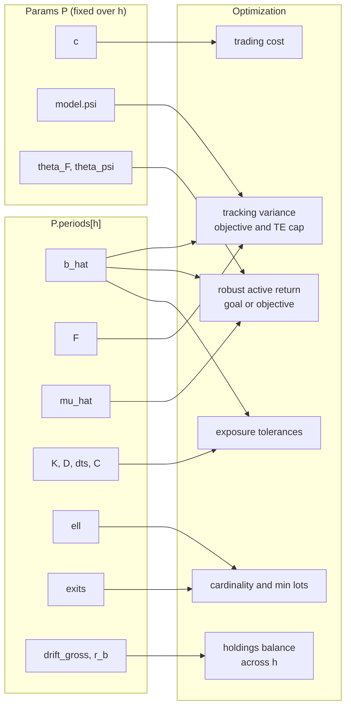
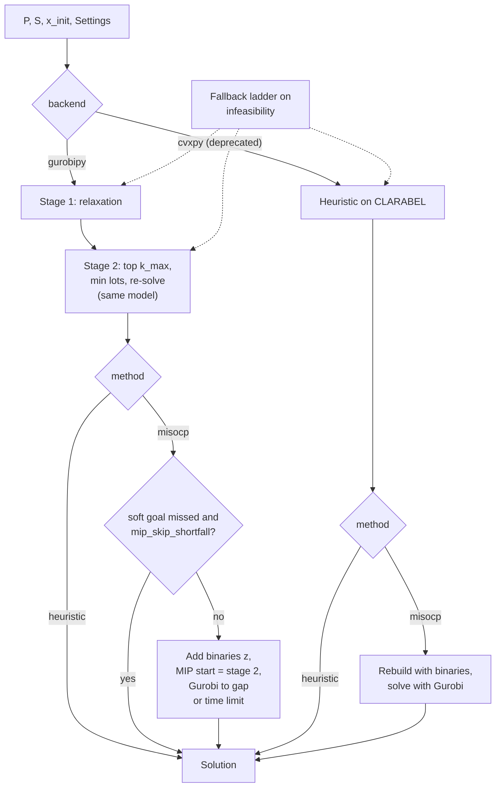

# Model

`solve_rebalance(P, S, x_init, settings)` (`src/optimize/model.py`) plans portfolios for periods $h = 0, \dots, H-1$ from one `Params` and returns them. Only period 0 is traded. Later periods exist so that today's trade accounts for next month's drift, exits and costs.

## From estimation to model

| input | enters as |
|---|---|
| `b_hat` | centre of every active quantity: $a_h = x_h - \hat b_h$, centre of the tolerance bands, weight cap $\hat b + \bar w$ |
| `F`, `model.psi` | tracking variance $V_h = \|F_h^\top a_h\|^2 + \sum_i \psi_i a_{h,i}^2$ |
| `mu_hat`, `theta_F`, `theta_psi` | $\rho_h = \hat\mu_h^\top a_h - \varepsilon_2 \|\Theta^{1/2} a_h\|$, with $\|\Theta^{1/2} a\|^2 = \|\Theta_F^\top a\|^2 + \sum_i \theta_{\psi,i} a_i^2$ |
| `K`, `D`, `dts`, `C` | active exposure constraints |
| `c` | trading cost $c^\top(u^+ + u^-)$ |
| `ell`, `exits` | minimum lot and forced zero holdings |
| `drift_gross`, `r_b` | drifted portfolio $\tilde x_h$ for $h \ge 1$ |

$\rho_h$, the robust active return (`robust_active`), is the expected active return less a penalty for estimation error in $\hat\mu$. It is zero when holding the benchmark.

## Candidate set

`loop.candidates(P, hold, k_max, H, n_cand, max_active_w)` cuts the $n$ bonds to $S$. Eligible bonds are not stale, not exiting at $h=0$, have a finite $\hat\mu$, and at every planning period have $\ell_i \le 0.5 / k_{max}$ and $\ell_i \le \hat b_i + \bar w$. $S$ is the `n_cand` (750) largest eligible benchmark weights plus every current holding. `x_init` is the current holdings on $S$ (zero at the first date, the portfolio starts in cash).

Tracking is still measured against the full benchmark. A bond outside $S$ has active weight $-\hat b_i$, which adds a constant to every norm.

## Formulation

Variables per period $h$: weights $x_h \in \mathbb{R}^{|S|}$, buys and sells $u_h^+, u_h^- \ge 0$, and in the MISOCP binaries $z_h$.

Tracking mode (`objective = "tracking"`):

$$\min \sum_{h=0}^{H-1} \Big[\, \gamma\, \omega_h V_h + \kappa\, c^\top (u_h^+ + u_h^-) + \lambda\, \omega_h s_h \,\Big] \quad \text{s.t.} \quad \rho_h + s_h \ge g_m,\; s_h \ge 0$$

$s_h$ is the monthly goal shortfall, $\lambda$ = `goal_penalty`. With `goal_penalty = None` the goal is hard, $\rho_h \ge g_m$, with no $s_h$.

Return mode (`objective = "return"`): no goal constraint, a small $\gamma$ breaks ties.

$$\min \sum_{h=0}^{H-1} \Big[\, -\omega_h \rho_h + \gamma\, \omega_h V_h + \kappa\, c^\top (u_h^+ + u_h^-) \,\Big]$$

Constraints, every $h$, both modes:

| constraint | form |
|---|---|
| balance | $x_h - \tilde x_h = u_h^+ - u_h^-$, with $\tilde x_0 = x^{init}$, $\tilde x_h = \mathrm{diag}(\text{drift\_gross}_h)\, x_{h-1} / (1 + r^b_h)$ |
| budget, no shorting | $\mathbf 1^\top x_h = 1$, $x_h \ge 0$ |
| active weight cap | $x_h \le \hat b_h + \bar w$ |
| duration | $\lvert D_h^\top a_h \rvert \le \sigma \delta_D$ |
| key rates | $\lvert K_{h,j}^\top a_h \rvert \le \sigma \delta_{K,j}$, $j = 1..8$ |
| DTS | $\lvert \mathrm{dts}_h^\top a_h \rvert \le \sigma \delta_{DTS}$ |
| convexity | $\lvert C_h^\top a_h \rvert \le \sigma \delta_C$ |
| ex-ante tracking error | $\sqrt{12\, V_h} \le \sigma \cdot \text{te\_cap}$ |
| exits | $x_{h,i} = 0$ for $i \in E_h$ |
| cardinality, min lot | $\ell_{h,i} z_{h,i} \le x_{h,i} \le u_i z_{h,i}$, $\sum_i z_{h,i} \le k_{max}$, $u_i = \min(1, \hat b_i + \bar w)$ |

$\omega_h$ = `omega` (default $1/H$ each), $\kappa$ = `cost_weight`, $\bar w$ = `max_active_w`, $\sigma$ the fallback scale (1 unless infeasible). Values are in [05_settings.md](05_settings.md).

## Tolerance bands

`bands(q, settings)` gives the half-widths $\delta$ at each period.

- `tol_mode = "flat"`: $\delta_D, \delta_K, \delta_{DTS}, \delta_C$ as set, the same for all 8 key rates.
- `tol_mode = "relative"` (the default config): $\delta = \max(\text{tol\_rel} \cdot \lvert \hat b_h^\top v \rvert,\ \text{floor})$ per exposure $v$ and per key rate, so the band is a share of the benchmark's own exposure. $\delta_D$ stays flat in both modes.

Example at 2022-01-31, medium risk tolerance (tol_rel 0.10): benchmark 10y KRD 2.15 gives a band of $\pm 0.215$; 6m KRD 0.007 gives the floor $\pm 0.02$.

## Cardinality: two methods

`method = "heuristic"` (the default config): stage 1 solves the continuous relaxation without $z$ or $k_{max}$. Stage 2 keeps the $k_{max}$ bonds with the largest stage-1 weight over all periods (bonds exiting at any period excluded), fixes the rest to 0, lifts the kept ones to at least their minimum lot, and re-solves. Not guaranteed optimal.

`method = "misocp"`: after the heuristic, binaries $z$ are added and Gurobi solves the MISOCP with the heuristic as the MIP start. Binaries exist only for the heuristic's picks plus the `mip_cand` largest stage-1 weights; the rest are fixed to 0. Gurobi stops at `mip_gap` or `time_limit` and returns its best incumbent (status `user_limit` on the time limit). With `mip_skip_shortfall`, a month where the heuristic already misses a soft goal returns the heuristic.

## Solve paths

`Settings.backend = "gurobipy"` (`grb.py`) is the primary backend: relaxation, stage 2 and the MIP run in one Gurobi model, changing bounds in place. The `"cvxpy"` backend (CLARABEL for the heuristic, Gurobi through cvxpy for the MISOCP) builds a new problem per step, is much slower for the MISOCP, and is to be deprecated.

Fallback ladder (`_ladder`), tried in order until feasible. Widening multiplies every $\delta$ and the TE cap by $\sigma$.

| goal | steps |
|---|---|
| soft (tracking with `goal_penalty`, the default config) or return mode | $\sigma$ = 1, 2, 4, 8 |
| hard | keep goal at 1, drop goal at 1, then $\sigma$ = 2, 4, 8 with the goal dropped |

Stage 2 starts its ladder where stage 1 ended. The scale used is reported as `delta_scale`, a dropped goal as `return_goal_dropped`.

Numerics: solver weights are in percent and the objective is multiplied by $10^3$, because raw weights (about $4 \times 10^{-3}$) sit near Gurobi's tolerances. The quadratic terms enter as epigraph constraints.

## Output

`Solution`:

| field | meaning |
|---|---|
| `x` | list of $H$ arrays on $S$, the planned weights (`x[0]` is traded) |
| `trades_plus`, `trades_minus` | $h = 0$ buys and sells |
| `support` | bonds held at $h = 0$ |
| `status` | `optimal`, `optimal_inaccurate`, `user_limit` |
| `delta_scale`, `return_goal_dropped` | fallback ladder outcome |
| `track_var` | forecast monthly tracking variance of `x[0]` over all $n$ bonds |
| `robust_active` | $\rho_0$, monthly |
| `shortfall` | $\max(0, g_m - \rho_0)$ |
| `seconds`, `info` | solve time, method, objective, MIP gap and nodes |

Example at 2022-01-31 (corporate + treasury, $g$ = 50 bp/yr, medium, $k_{max}$ = 150, $H$ = 2, gurobipy heuristic, relative bands, $|S|$ = 1000): status optimal, 150 bonds held, ex-ante TE 17.7 bp/yr against a 50 bp cap, $\rho_0$ = 4.45 bp/month against a 4.16 bp goal, no shortfall, $\sigma$ = 1, 0.3 s.
