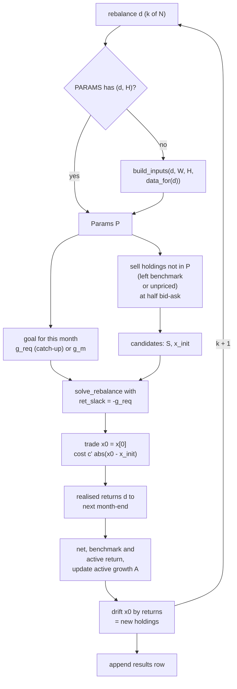

# Rolling loop

`rolling.run(settings, REB, ends, data, data_for, table, W, PARAMS, N_CAND, CATCH_UP)` (`src/optimize/rolling.py`) runs one solve per rebalance month-end over the horizon and returns one row per rebalance. Notebook sections 6 to 8.

## One month

## Steps

1. Estimate. `build_inputs` at $d$ with the month's benchmark, cached in `PARAMS` by `(d, H)`. Re-running with a different risk tolerance, mode or `k_max` reuses it. The key does not include asset types, so clear `PARAMS` after changing `ASSET_TYPES`.
2. Goal. Tracking mode with catch-up on: the monthly goal is reset (below). Otherwise $g_m$.
3. Forced sales. Holdings whose cusip is not in `P.cusips` are sold at half their last bid-ask in the 90 days to $d$ (else their cost at the previous rebalance). This is `exit_cost`. The remaining holdings are rescaled to post-sale wealth and sum below 1, so the solve reinvests the cash and pays the buy cost on it.
4. Solve from the drifted holdings (`candidates`, then `solve_rebalance`). Trade cost $\text{cost} = c_S^\top \lvert x_0 - x^{init} \rvert$.
5. Measure. `realised_returns`: month-end dirty prices plus coupons paid between $d$ and the next month-end. A bond with a stale price at either end, or no valid return, takes its $\hat\mu$.

$$r^{port} = (1 - \text{exit\_cost})(1 - \text{cost})(1 + x_0^\top r_S) - 1, \qquad r^{bench} = \hat b_0^\top r, \qquad \text{active} = r^{port} - r^{bench}$$

6. Drift. New holdings $x_{0,i}(1 + r_i) / (1 + x_0^\top r_S)$ for bonds above $10^{-9}$, and $A \leftarrow A\,(1 + r^{port}) / (1 + r^{bench})$.

## Goal catch-up

$g$ is a goal over the whole horizon, so in tracking mode (`CATCH_UP["on"]`) each month asks for the monthly rate that still reaches it from the cumulative active growth $A$ so far:

$$g_{req} = \operatorname{clip}\!\left( \left( \frac{(1 + g_m)^N}{A} \right)^{1/(N - k)} - 1,\ \text{floor},\ \text{cap} \cdot g_m \right)$$

with `cap = 2`, `floor = 0`. Behind the goal it asks for at most twice the original rate; ahead of it, no less than the benchmark. Return mode ignores the goal in the objective, so catch-up is off.

Example, 3 months from 2022-01, $g$ = 50 bp/yr ($g_m$ = 4.16 bp): January earned +12.8 bp active, already ahead of the 3-month target, so February and March aimed for 0.

## Results

One row per rebalance date:

| column | meaning |
|---|---|
| `ret_port`, `ret_bench`, `active` | monthly net portfolio, benchmark and active return |
| `cost`, `exit_cost` | total cost share of wealth, and the forced-sale part |
| `turnover` | sum of buys, $\sum \max(0, x_0 - x^{init})$ (1.0 the first month) |
| `n_hold`, `n_bonds` | bonds held, benchmark bonds in `P` |
| `te_fcst_ann`, `te_cap_ann` | ex-ante annualized TE, and the cap after widening |
| `act_D` | active duration |
| `goal_req`, `robust_active`, `shortfall` | goal this solve aimed for, $\rho_0$, shortfall against `goal_req` (monthly) |
| `goal_dropped`, `mip_skipped`, `delta_scale`, `status`, `seconds` | solve diagnostics |

Example rows (settings as in the 03_model example):

| date | ret_port | ret_bench | active | cost | turnover | n_hold | te_fcst_ann | goal_req |
|---|---|---|---|---|---|---|---|---|
| 2022-01-31 | -1.042% | -1.170% | +12.8 bp | 1.5 bp | 1.000 | 150 | 17.7 bp | 4.16 bp |
| 2022-02-28 | -2.634% | -2.759% | +12.5 bp | 0.2 bp | 0.144 | 150 | 16.4 bp | 0 |
| 2022-03-31 | -4.239% | -3.956% | -28.3 bp | 0.6 bp | 0.100 | 150 | 15.7 bp | 0 |

`summary(res)` in the notebook reports cumulative portfolio and benchmark returns, annualized active return $\left(\prod(1+r^{port}) / \prod(1+r^{bench})\right)^{12/N} - 1$ against $g$, realised TE (annualized standard deviation of monthly active returns) against the average forecast and the cap, turnover, cost, holdings, months with a shortfall, months with widened tolerances, months where the MIP was skipped, and solve time.

Section 8 re-runs the loop for every risk tolerance and mode at the same inputs, reusing `PARAMS`. A combination whose goal fails the information ratio check (see [05_settings.md](05_settings.md)) is skipped with its message.
