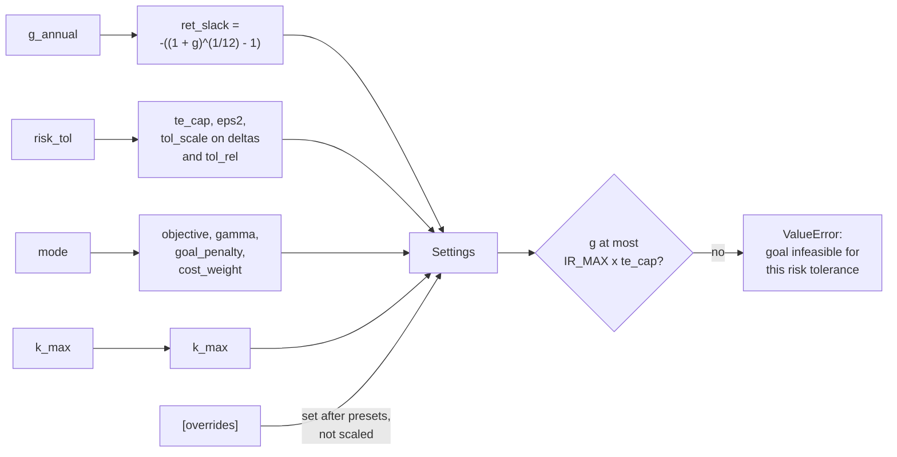

# Settings

`[inputs]` in `configs/goal.toml` holds only what a user enters (`RunConfig`, `src/backtest/config.py`). `presets.make_settings` turns it into a `Settings` (`src/optimize/model.py`), and `[overrides]` can then set any field.

## User inputs

| input | example | used for |
|---|---|---|
| `asset_types` | `["corporate", "treasury"]` | benchmark sleeve, any subset of corporate, treasury, mbs |
| `g_annual` | 0.0050 | annual active return goal over the benchmark |
| `start`, `T` | `"2022-01"`, 2 | first rebalance and $N = 12T$ monthly rebalances |
| `risk_tol` | `"medium"` | low, medium, high |
| `k_max` | 150 | maximum bonds held |
| `W` | 1,000,000 | wealth in dollars, sets minimum-lot weights |
| `mode` | `"tracking"` | tracking or return |

## Presets

Risk tolerance. Low is tight on all three.

| | `te_cap` (annual) | `eps2` | `tol_scale` |
|---|---|---|---|
| low | 25 bp | 0.50 | 0.5 |
| medium | 50 bp | 0.25 | 1.0 |
| high | 100 bp | 0.10 | 2.0 |

`tol_scale` multiplies `delta_D`, `delta_K`, `delta_DTS`, `delta_C` and `tol_rel`. The relative-mode floors are not scaled.

Mode:

| | `gamma` | `goal_penalty` | `cost_weight` |
|---|---|---|---|
| tracking | 3000 | 100 (soft goal) | 1 |
| return | 10 (tie-breaker) | None (no goal) | 1/12 (cost spread over a year) |

Return mode needs `cost_weight` below 1: otherwise one month of extra return is weighed against the full one-off trading cost, and it barely trades.

Information ratio check: `make_settings` raises if $g >$ `IR_MAX` $\times$ `te_cap` (`IR_MAX = 1`). Medium allows at most 50 bp/yr.

`omega` defaults to $1/H$ per period unless overridden. All preset values are placeholders until calibration.

## Default overrides

| field | value | why |
|---|---|---|
| `H` | 2 | two planning periods |
| `method` | `"heuristic"` | relax then truncate |
| `backend` | `"gurobipy"` | primary backend |
| `tol_mode` | `"relative"` | bands as a share of benchmark exposure |
| `time_limit` | 5 | Gurobi seconds per MIP |
| `mip_gap`, `mip_focus`, `mip_cand`, `mip_skip_shortfall` | 1e-2, 2, 150, True | MIP controls (used with `method="misocp"`) |

Overrides are taken as given: a tolerance set here is not scaled by the risk tolerance.

Two loop inputs are not `Settings` fields. They are passed to `loop.run` directly.

| input | value | meaning |
|---|---|---|
| `n_cand` | 750 | candidate set size: the `n_cand` largest eligible benchmark weights plus current holdings ([03_model.md](03_model.md)) |
| `[catch_up]` | `on=True, cap=2.0, floor=0.0` | goal catch-up ([04_rolling.md](04_rolling.md)) |

## All fields

| group | field | default | meaning |
|---|---|---|---|
| objective | `objective` | tracking | tracking or return |
| | `H`, `omega` | 2, (0.5, 0.5) | planning periods and their weights on the variance, goal and return terms |
| | `gamma` | 3000 | weight on tracking variance relative to trading cost |
| | `cost_weight` | 1 | multiplier on trading cost |
| | `goal_penalty` | None | None = hard goal, else cost per unit of monthly shortfall |
| goal | `ret_slack` | 0.0025 | minus the monthly goal: constraint is $\rho \ge$ `-ret_slack` (set from $g$ by the presets) |
| | `eps2` | 0.5 | weight on estimation error in $\rho$ |
| holdings | `k_max` | 150 | maximum bonds held |
| | `max_active_w` | 0.02 | $x_i \le \hat b_i + 0.02$ |
| tolerances | `delta_D` | 0.25 | active duration, years (flat in both modes) |
| | `delta_K`, `delta_DTS`, `delta_C` | 0.20, 0.0025, 15 | flat-mode bands |
| | `tol_mode` | flat | flat or relative |
| | `tol_rel` | 0.10 | relative-mode share of the benchmark exposure |
| | `floor_K`, `floor_DTS`, `floor_C` | 0.02, 0.0005, 2 | relative-mode floors |
| | `te_cap` | None | annual ex-ante TE cap, required in return mode |
| estimation | `psi_floor` | False | lift `psi` to the sector median (off: estimation already shrinks it) |
| path | `method` | heuristic | heuristic or misocp |
| | `backend` | cvxpy | cvxpy or gurobipy (the default config sets gurobipy) |
| | `solver`, `mip_solver` | CLARABEL, GUROBI | cvxpy backend solvers |
| MIP | `mip_gap` | 1e-2 | relative gap at which Gurobi stops |
| | `mip_focus` | 2 | Gurobi MIPFocus |
| | `time_limit` | 120 | seconds per MIP, best incumbent used |
| | `mip_cand` | 150 | binaries only on this many largest stage-1 weights plus the heuristic's picks, None = all |
| | `mip_warm` | True | cvxpy backend: heuristic as MIP start (always on in gurobipy) |
| | `mip_skip_shortfall` | True | gurobipy, soft goal: keep the heuristic when it misses the goal |
