# Documentation

GoalPath-Bond holds at most `k_max` bonds and tracks a benchmark: the iShares AGG holdings cut to the asset types the user picks (corporate, treasury, mbs). It aims for an annualized active return goal `g` within a risk tolerance. At each month-end it estimates a risk and return model from data up to that date, solves a multi-period optimization, trades the first period, and measures the realised return to the next month-end.

The driver is `workbook/goal_optimizer.ipynb`. These documents follow it.

## Reading order

| file | covers |
|---|---|
| [01_data.md](01_data.md) | tables the model reads, the month-end panel, the monthly benchmark, data grain at each stage |
| [02_estimation.md](02_estimation.md) | `build_inputs`: every estimated input, how it is computed, output shapes |
| [03_model.md](03_model.md) | how the estimates enter the optimization, objective, constraints, solve paths |
| [04_rolling.md](04_rolling.md) | the monthly loop, cost and return accounting, goal catch-up, results |
| [05_settings.md](05_settings.md) | user inputs, presets, every `Settings` field |

## End to end

```mermaid
%%{init: {"flowchart": {"wrappingWidth": 1000}, "markdownAutoWrap": false, "themeCSS": ".node .label div, .node .nodeLabel, .node p { text-align: left !important; }"}}%%
flowchart TD
    UI["User inputs<br/>ASSET_TYPES, G_ANNUAL,<br/>START_DATE, T_YEARS,<br/>RISK_TOL, K_MAX, W, MODE"] --> ST["presets.make_settings<br/>Settings"]
    UI --> HZ["presets.horizon_dates<br/>N = 12 T rebalance<br/>month-ends"]

    DP["data/processed<br/>(built by data_cleaning)"] --> LD["params.load_data<br/>universe, prices,<br/>curve, month-end panel"]
    HM["agg_holdings_monthly"] --> BM["notebook data_for(d)<br/>benchmark weights b<br/>for month d"]

    HZ --> LOOP{"next rebalance d"}
    LOOP --> EST["params.build_inputs<br/>Params P: risk model,<br/>exposures, forecasts,<br/>costs, lots"]
    LD --> EST
    BM --> EST
    EST --> CAND["rolling.candidates<br/>candidate set S,<br/>holdings x_init"]
    CAND --> SOLVE["solve_rebalance<br/>plan H periods"]
    ST --> SOLVE
    SOLVE --> EXE["rolling.run<br/>trade period 0,<br/>pay costs, realised<br/>return to next month"]
    EXE -->|"drifted holdings"| LOOP
    EXE --> RES["results: one row<br/>per rebalance,<br/>summary vs g,<br/>sensitivity grid"]
```

## Code map

| module | role |
|---|---|
| `src/params/inputs.py` | `load_data`, `build_inputs`, the `Params` and `PeriodInputs` containers |
| `src/params/prices.py` | load processed tables, month-end price panel |
| `src/params/krd.py` | cash flows, repricing off the curve, key-rate durations, duration, spread duration, convexity |
| `src/params/covariance.py` | key-rate changes, covariance `Sigma`, PCA |
| `src/params/residual.py` | residual returns, credit factors, residual variance `psi` |
| `src/params/factor_model.py` | factor loadings `F`, tracking variance, estimation-error covariance `Theta` |
| `src/params/forecast.py` | expected returns, benchmark drift, exits |
| `src/params/frictions.py` | trading costs, minimum lots |
| `src/optimize/presets.py` | user inputs to `Settings`, horizon checks |
| `src/optimize/model.py` | `Settings`, `Solution`, `solve_rebalance`, tolerance bands, the cvxpy backend |
| `src/optimize/grb.py` | gurobipy backend (primary) |
| `src/optimize/rolling.py` | candidate set, goal catch-up, the monthly loop |
| `src/optimize/backtest.py` | `realised_returns` and `exit_cost`, used by the loop |

## Conventions

Dates are month-ends. Returns and covariances are monthly and in decimals. Weights sum to 1. Durations are in years per unit (decimal) yield change. Active weights are $a = x - \hat b$ over every benchmark bond, so a bond the portfolio does not hold has $a_i = -\hat b_i$.

## Notation

| symbol | code | meaning |
|---|---|---|
| $n$ | `len(P.cusips)` | benchmark bonds priced at the as-of date |
| $S$ | `S` | candidate bonds the optimizer may hold (indices into `P.cusips`) |
| $H$, $h$ | `H`, `h` | planning periods per solve, period index ($h = 0$ is traded) |
| $\hat b_h$ | `b_hat` | benchmark weights forecast for period $h$ |
| $x_h$ | `sol.x[h]` | portfolio weights on $S$ |
| $F_h$, $\psi$ | `F`, `model.psi` | factor loadings and residual variances, $Q = F F^\top + \mathrm{diag}(\psi)$ |
| $\Theta$ | `theta_F`, `theta_psi` | covariance of the error in $\hat\mu$ |
| $\hat\mu_h$ | `mu_hat` | expected one-month returns |
| $\rho_h$ | `robust_active` | robust active return, $\hat\mu_h^\top a_h - \varepsilon_2 \lVert \Theta^{1/2} a_h \rVert$ |
| $K, D, D^{spr}, \mathrm{dts}, C$ | `K`, `D`, `D_spr`, `dts`, `C` | key-rate durations, duration, spread duration, duration times spread, convexity |
| $c$ | `c` | one-way proportional trading cost |
| $\ell_h$ | `ell` | minimum lot as a weight |
| $E_h$ | `exits` | bonds that cannot be held in period $h$ |
| $g$, $g_m$ | `G_ANNUAL`, `-ret_slack` | annual active goal, monthly goal $(1+g)^{1/12} - 1$ |

## Status

Proof of concept. Risk tolerance presets, tolerances and penalties are placeholders until calibration. MBS inputs are rough (bullet cash flows, no prepayment model). The data pipeline itself (`data_cleaning/`) is documented and maintained separately.
