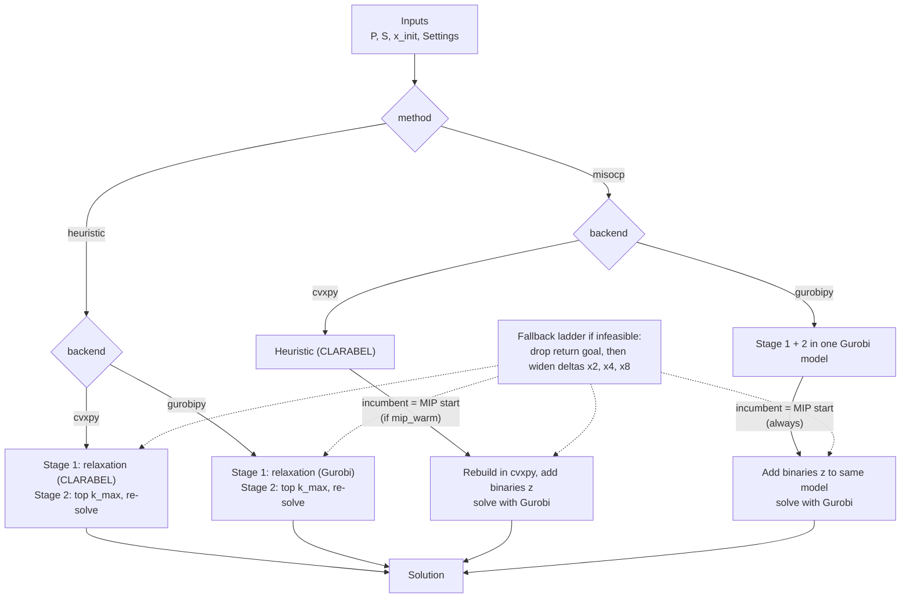

# Solve pathways

`solve_rebalance(P, S, x_init, s)` in `model.py`. `Settings.method` picks what is solved, `Settings.backend` picks the solver.

Heuristic outputs are the stage-2 solution. MIP outputs are the best Gurobi incumbent, stopping at `mip_gap` or `time_limit`.

## Inputs

- `P`: `src.params` Params for one date. Per bond: `c`, `model.psi`, `theta_F`, `theta_psi`. Per planning date `periods[h]`: `b_hat`, `F`, `ell`, `exits`, `D`, `D_spr`, `C`, `K`, `mu_hat`, `drift_gross`, `r_b`.
- `S`: candidate index set (400 largest benchmark weights plus current holdings in the backtest).
- `x_init`: current drifted holdings on `S`.
- `Settings`:
  - Objective: `H`, `omega`, `gamma`
  - Constraints: `k_max`, `max_active_w`, `delta_D`, `delta_K`, `delta_S`, `delta_C`, `eps2`, `ret_slack`
  - Estimation: `psi_floor` (applied to `P` by the backtest, off by default since `src.params` shrinks psi)
  - Path: `method`, `backend`
  - Solver: `solver`, `mip_solver`
  - MIP: `mip_gap`, `mip_focus`, `time_limit`, `mip_cand`, `mip_warm`
